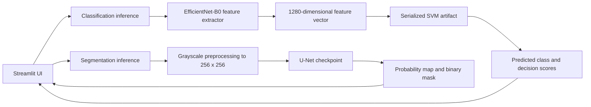

# NeuroScan-AI

NeuroScan-AI is a research-oriented application for exploring brain MRI images with a tumor-classification pipeline and a U-Net segmentation pipeline. A Streamlit interface connects image uploads to the project's existing inference code and presents model outputs for educational and research use.

> **Research and education only.** NeuroScan-AI is not a medical diagnostic device and must not be used for clinical decisions.

## Project introduction

Brain MRI analysis involves both image-level categorization and pixel-level localization. This project provides two separate machine-learning workflows to explore those tasks:

- Predict one of four image classes with EfficientNet-B0 feature extraction followed by an SVM.
- Produce a pixel-wise tumor mask with a U-Net segmentation model.

The project objectives are to provide a clear interface for those workflows, document the data and model assumptions, and make the experiments easier for a research or engineering team to hand over. The outputs are model predictions, not diagnoses.

## Features

- **Brain tumor classification:** upload an image and display the predicted class label.
- **Brain tumor segmentation:** display the model input, binary mask, probability map, and mask overlay.
- **MRI image processing:** use the classification transform supplied by the selected torchvision weights, and grayscale resize-and-pad preprocessing for segmentation.
- **Visual prediction results:** review classification and segmentation outputs in the Streamlit interface.
- **Four classification labels:** `glioma`, `meningioma`, `no_tumor`, and `pituitary`.

The current classification inference function returns raw decision scores, not calibrated class probabilities. The interface should not present them as confidence.

## Technologies used

| Area | Technologies |
|---|---|
| Application | Python, Streamlit |
| Classification | PyTorch, Torchvision EfficientNet-B0, scikit-learn SVM, Joblib |
| Segmentation | PyTorch, U-Net, NumPy, Pillow |
| Notebook research | Pandas, Matplotlib, Seaborn, ImageHash, tqdm, XGBoost |
| Optional test tooling | Pytest |

PyTorch and Torchvision must be installed as a compatible pair. The appropriate wheel depends on the operating system, Python version, CPU/GPU choice, and CUDA runtime.

## System architecture



See [Project overview](docs/PROJECT_OVERVIEW.md) and [Model documentation](docs/MODEL_DOCUMENTATION.md) for implementation details.

## Classification methodology

The inference module uses the torchvision EfficientNet-B0 default weights and their associated image transform. The model's classification head is replaced with an identity layer so it emits a 1,280-dimensional feature vector. A serialized SVM model then predicts one of four classes.

The experiment metadata describes the classification pipeline as `StandardScaler` followed by an SVM with an RBF kernel (`C=10`, `gamma="scale"`). The scaler is included for the pipeline artifact identified in the metadata.

The two serialized SVM artifacts represent different experiments:

- `models/best_svm_pipeline.joblib`: cleaned-training experiment.
- `models/best_svm_full_5000.joblib`: original 5,000-image training experiment.

**Runtime artifact note:** `src/classification/inference.py` defaults to `models/best_svm_full_5000.joblib`, and the current UI calls that default. The cleaned experiment is the primary reported result below, but the live interface does not automatically select its artifact. Confirm the intended runtime artifact before a handover or public demonstration; do not treat the cleaned result as the live UI model's measured performance.

## Segmentation methodology

The segmentation network is a single-channel U-Net. Inference converts an uploaded image to grayscale, scales it to fit within 256 × 256 pixels, centers it on a zero-valued canvas, and normalizes pixel values to `[0, 1]`. The model emits logits; inference applies a sigmoid to obtain a probability map and thresholds it at `0.5` to produce a binary mask.

The current inference function returns the preprocessed input, probability map, and binary mask. It does not calculate ground-truth evaluation metrics. The training and test-evaluation notebooks are experimental workflows, described separately in [Model documentation](docs/MODEL_DOCUMENTATION.md).

## Installation and setup

1. Clone the repository from the project team's Git remote:

   ```shell
   git clone <repository-url>
   cd brain-tumor
   ```

2. Create and activate a virtual environment:

   ```shell
   python -m venv .venv
   ```

   Windows PowerShell:

   ```powershell
   .\.venv\Scripts\Activate.ps1
   ```

   macOS/Linux:

   ```shell
   source .venv/bin/activate
   ```

3. Install PyTorch and Torchvision. Select the compatible CPU or CUDA command using the [official PyTorch installation selector](https://pytorch.org/get-started/locally/).

4. Install the project dependencies:

   ```shell
   python -m pip install -r requirements.txt
   ```

   This file includes both runtime packages and optional notebook/research tools. For a runtime-only environment, install just the first group:

   ```shell
   python -m pip install streamlit torch torchvision numpy Pillow joblib scikit-learn
   ```

   Add the second group (`pytest pandas matplotlib ImageHash seaborn tqdm xgboost`) only when using notebook research or test tooling.

5. Confirm that the required model artifacts are available:

   - The two classification `.joblib` artifacts are present under `models/`.
   - The segmentation checkpoint expected at `models/segmentation/best_unet.pth` is **not present** in this repository. It must be supplied separately at that path. The path is ignored by `.gitignore`.
   - The torchvision default EfficientNet-B0 weights may need to be downloaded by torchvision at first use if they are not already cached. Ensure the runtime can access the weights or has them cached.

6. From the repository root, start the application:

   ```shell
   streamlit run apps/app.py
   ```

For a complete handover, see the [setup guide](docs/SETUP_GUIDE.md).

## Usage

1. Open the Streamlit application and choose **Brain Tumor Classification** or **Brain Tumor Segmentation** from the navigation.
2. Upload a supported MRI image (`JPG`, `JPEG`, `PNG`, `BMP`, `TIF`, or `TIFF`).
3. Review the image preview and start the chosen analysis.
4. For classification, review the predicted class. No calibrated confidence score is returned by the existing classifier.
5. For segmentation, compare the uploaded image, model input, predicted mask, and overlay; expand the probability-map view if needed.

The segmentation UI's mask-pixel count and coverage are descriptive properties of the predicted mask, not accuracy metrics.

## Repository structure

```text
brain-tumor/
├── apps/
│   ├── app.py
│   └── ui_components.py
├── configs/
│   └── .gitkeep
├── docs/
│   ├── CONTRIBUTING.md
│   ├── DATASET_DOCUMENTATION.md
│   ├── MODEL_DOCUMENTATION.md
│   ├── PROJECT_OVERVIEW.md
│   ├── SETUP_GUIDE.md
│   └── dataset/
│       └── classification_dataset_audit.md
├── models/
│   ├── best_svm_full_5000.joblib
│   ├── best_svm_pipeline.joblib
│   └── metadata/
├── notebooks/
│   ├── classification/
│   └── segmentation/
├── src/
│   ├── classification/
│   │   └── inference.py
│   └── segmentation/
│       ├── inference.py
│       └── unet_model.py
├── tests/
│   ├── test_classification_inference.py
│   └── test_segmentation_inference.py
├── .gitattributes
├── .gitignore
├── LICENSE
├── package-lock.json
├── README.md
└── requirements.txt
```

The MRI datasets and the segmentation checkpoint are not included in the repository. `package-lock.json` is currently an empty Node.js lockfile with no accompanying `package.json`; see the [setup guide](docs/SETUP_GUIDE.md).

## Model performance

The figures below are copied from the committed experiment metadata. The cleaned-training result is the primary reported classification result.

| Experiment | Training samples | Test samples | Test accuracy | Artifact |
|---|---:|---:|---:|---|
| Cleaned training data (primary) | 3,891 | 1,000 | **88%** | `best_svm_pipeline.joblib` |
| Original training data (supplementary) | 5,000 | 1,000 | 97% | `best_svm_full_5000.joblib` |

The dataset audit identified **101 exact duplicate test images** across the original training and test sets, in 98 cross-split duplicate groups. The original-dataset result may therefore be affected by data leakage and must not be interpreted as a leakage-free estimate. The cleaned experiment is the more appropriate primary result, but it does not establish clinical performance.

Metadata sources: [`cleaned_experiment.json`](models/metadata/cleaned_experiment.json), [`full_dataset_experiment.json`](models/metadata/full_dataset_experiment.json), and [`best_svm_metadata.json`](models/metadata/best_svm_metadata.json).

## Limitations

- The project is for research and educational exploration only.
- Dataset composition, labeling, duplication, and split design constrain the conclusions that can be drawn.
- Performance on the available test set may not generalize to other scanners, institutions, populations, acquisition protocols, or image formats.
- The segmentation checkpoint is not included, and inference output alone does not establish segmentation quality.
- Independent clinical validation and appropriate regulatory review would be necessary before any clinical use.

## Disclaimer

NeuroScan-AI is not a medical device. It does not provide a diagnosis, treatment recommendation, or substitute for professional medical advice. Model outputs may be incorrect and must not be used to make clinical decisions.

## License

This project is distributed under the [MIT License](LICENSE). Dataset and pretrained-model terms may be separate; verify those terms independently before redistribution or use.

## Screenshots

Screenshots of the current Streamlit interface are intentionally not included yet. Add genuine captures after the interface is ready for review; no screenshots are fabricated here.
