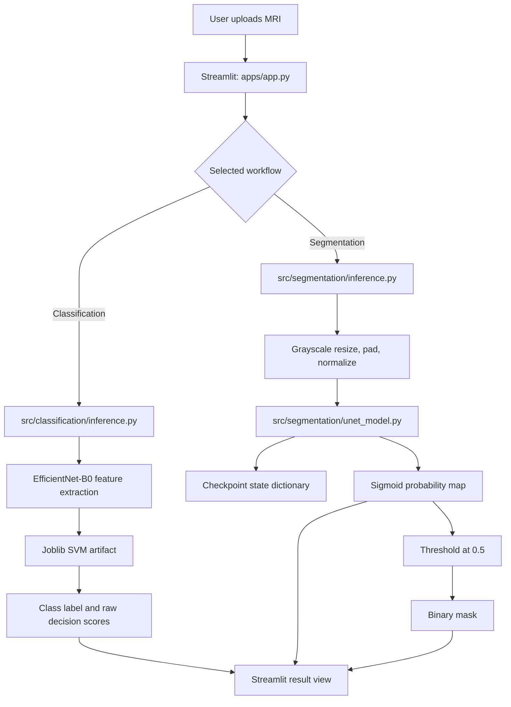
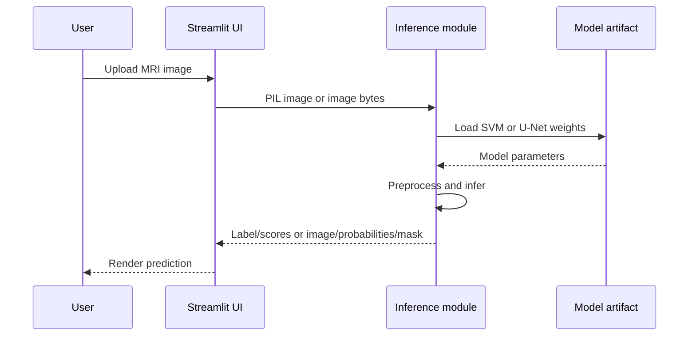

# Project overview

NeuroScan-AI is a research and educational application for exploring two brain MRI tasks: image-level tumor classification and pixel-level tumor segmentation. The Streamlit UI connects user-uploaded images to existing Python inference modules and renders their returned predictions. It is not a clinical system.

## System architecture

## Main modules and artifacts

| Path | Responsibility |
|---|---|
| `apps/app.py` | Streamlit navigation, upload handling, inference calls, and result presentation. |
| `apps/ui_components.py` | Reusable visual styling and shared interface components. |
| `src/classification/inference.py` | Loads EfficientNet-B0 and the serialized SVM, extracts features, and returns a class prediction. |
| `src/segmentation/inference.py` | Preprocesses an image, loads the U-Net checkpoint, and returns image, probabilities, and mask arrays. |
| `src/segmentation/unet_model.py` | Defines the U-Net and its double-convolution blocks. |
| `models/best_svm_pipeline.joblib` | Artifact associated with the cleaned classification experiment. |
| `models/best_svm_full_5000.joblib` | Artifact associated with the original 5,000-training-sample experiment; this is the current classification inference default. |
| `models/metadata/` | JSON metadata for the classification experiments. |
| `models/segmentation/best_unet.pth` | Required by the segmentation loader, but absent from the repository and ignored by `.gitignore`. |

## Classification workflow

1. The UI decodes the uploaded image as a PIL image.
2. `load_feature_extractor()` constructs torchvision EfficientNet-B0 with its default weights, replaces the classifier head with `Identity`, sets evaluation mode, and returns the weights-associated transform.
3. `extract_features()` converts the image to RGB, applies the transform, executes the feature extractor without gradients, and reshapes the output to a single feature vector. The experiment metadata identifies 1,280 features.
4. `load_classifier()` loads a Joblib artifact. Unless a path is supplied, the inference module selects `models/best_svm_full_5000.joblib`.
5. `predict_classification()` returns `predicted_class`, `predicted_label`, `decision_scores`, and `features`. Decision scores are not calibrated probabilities.

The cleaned experiment metadata names `best_svm_pipeline.joblib`, but the inference default and current UI use the full-dataset artifact. Selecting the cleaned artifact is a separate maintainer decision and requires confirming artifact compatibility.

## Segmentation workflow

1. The UI passes uploaded image bytes as a file-like object to `preprocess_image()`.
2. Preprocessing converts to grayscale, scales the image to fit inside 256 × 256 using bilinear resampling, centers it on a black canvas, normalizes pixels to `[0, 1]`, and returns a tensor with batch and channel dimensions.
3. `load_segmentation_model()` selects CUDA when available and CPU otherwise; it loads the checkpoint's `model_state_dict` into `UNet` and switches to evaluation mode.
4. `predict_segmentation()` runs without gradients, applies sigmoid to logits, and thresholds probabilities at `0.5`.
5. The function returns the preprocessed image, probability map, and binary mask as NumPy arrays. The UI visualizes these outputs and computes simple mask coverage for display; coverage is not an evaluation metric.

## Data flow and runtime boundary

Model loading and inference happen only after the user requests analysis. The UI caches loaded models as Streamlit resources. The application must be started from the repository root because model paths are relative to the current working directory.

## Research notebooks

The notebooks contain exploratory dataset audits, feature-extraction experiments, segmentation preprocessing, U-Net training, and a test-evaluation workflow. They include Google Colab imports and paths and are not directly portable to a local environment without adapting those paths and platform-specific cells. Notebook code is experimental; it should not be confused with the smaller inference modules.
